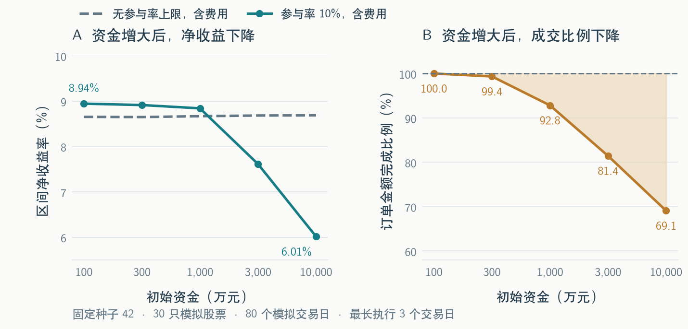
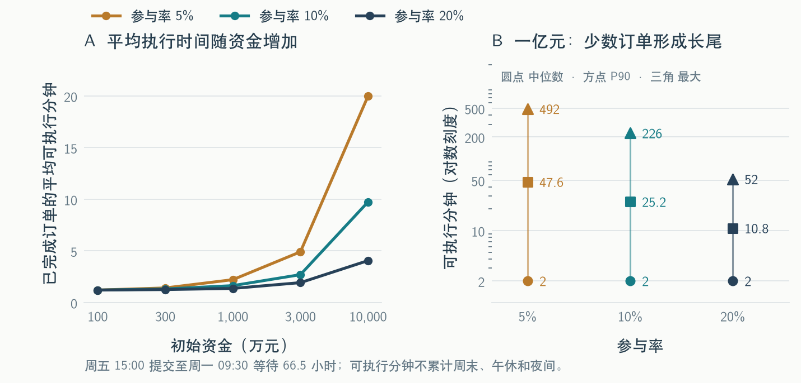

# 因子流动性回测：中文报告与 LaTeX bundle

**最新 L2 快照执行实验（2026-10-16）：** [中文报告](l2_tex_bundle/report.pdf)、[可编辑正文](l2_tex_bundle/main.tex)、[重绘与复现说明](l2_tex_bundle/README.md)及[完整 bundle](dist/factor_liquidity_l2_tex_bundle.zip)。采用两只股票、三个交易日的真实十档快照，比较同一批固定股数需求在参考价、可见盘口不限参与率和滞后参与率下的执行结果。普通余单当日终止；30/60 分钟是观察点，容量合格线未设。正式因子文件夹尚未接入，指定两股 2024 年 9 月 24 日前查询范围无记录。旧 `tex_bundle/` 和下文历史正文保留，旧分钟模型结果不代表 L2 结果。

本仓库整理了已经完成的合成数据验证和公司真实分钟样本回放，提供可直接阅读的中文 PDF、可编辑 LaTeX 源码、五组图表，以及可离线重绘的汇总数据和脚本。

**2026-10-16 追加实验：** [真实数据对照报告](experiments/2026-10-16/README.md)包含延长至9月9日的12股样本和扩大至30股、149个交易日的样本，新增同资金等权基准、已知分红送转账本及六组图。原有PDF与TeX正文保持原样。

**先读 [完整中文报告](tex_bundle/report.pdf)**，或下载 [完整 TeX bundle](dist/factor_liquidity_tex_bundle.zip)。GitHub 上可打开 PDF；若预览未加载，下载到本地阅读即可。报告以实验结论开头，接着解释因子、配置和指标，再分别介绍合成数据与真实数据并解读结果。订单尚未开始的情况用一段文字说明，不再单独作图；正文不包含下一步计划。

## 报告解释了什么

合成样本验证了目标权重、订单、共享成交额度、现金预算、部分成交、跨日余单、费用和净值的闭环。10% 参与率下，资金从 100 万增至 1 亿元，合成净收益从 8.9443% 降至 6.0142%，参考金额完成率从 100% 降至 69.0932%。这些结果说明模型约束确实改变了执行和持仓，不能当作因子真实收益证据。

真实样本来自实际公司 1 分钟行情，覆盖预先固定的 12 只股票、46 个交易日。10% 参与率下，区间净收益约为 −2.48% 至 −2.40%。已经开始买卖的订单均在三个交易日内完成；表中的订单金额完成比例约为 88.6%，是因为还计入了样本最后一天收盘后产生的新订单，而数据没有覆盖它们开始买卖的下一交易日。资金越大、参与率越低，部分订单完成买卖需要的交易时间越长。

报告用数字例子解释同股订单如何分用成交额度、不同股票如何共同使用现金，再逐图说明投资收益与成交结果。合成实验中，1亿元、10%参与率、三个交易日内未完成全部调仓需求；真实实验中，已有完整执行期的订单均成交，但持仓收益为负。





## 文件怎样看

| 文件或目录 | 用途 |
| --- | --- |
| [tex_bundle/report.pdf](tex_bundle/report.pdf) | 已编译的中文报告 |
| [tex_bundle/main.tex](tex_bundle/main.tex) | 正文、表格、图注及指标定义 |
| [tex_bundle/README.md](tex_bundle/README.md) | 编译、重绘、重新提取数据的具体步骤 |
| [tex_bundle/figures](tex_bundle/figures) | 五组嵌入中文字形的矢量 PDF 与高清 PNG |
| [tex_bundle/data](tex_bundle/data) | 报告使用的汇总数据及统计口径 |
| [tex_bundle/scripts/make_figures.py](tex_bundle/scripts/make_figures.py) | 修改图表风格并离线重绘 |
| [tex_bundle/scripts/prepare_data.py](tex_bundle/scripts/prepare_data.py) | 从本地既有回测输出提取图表汇总数据 |
| [dist/factor_liquidity_tex_bundle.zip](dist/factor_liquidity_tex_bundle.zip) | 包含报告、源码、图表、数据和脚本的完整包 |

## 快速使用

已有 TeX Live / MacTeX（含 ctex、Fandol、latexmk、LuaLaTeX）时：

```bash
git clone https://github.com/lsnnnnnnnn/factor_liquidity.git
cd factor_liquidity/tex_bundle
make pdf
```

修改 `main.tex` 后再次执行 `make pdf` 即可。现成图表已附在仓库里，仅编译报告不需要 Python 或数据库。Overleaf 也可上传 ZIP 内 `tex_bundle` 的内容，选择 **LuaLaTeX**，主文件设为 `main.tex`。本次使用 LuaLaTeX 验证了中文显示、文本提取与搜索所需的 Unicode 映射。

若需要重绘图表，详见 [bundle 使用说明](tex_bundle/README.md)。重绘读取附带 CSV，不重新运行策略；完整回测仍使用已有本地引擎仓库、授权数据和配置。公开仓库不包含公司原始分钟记录、完整逐笔账户账本、连接地址或凭据。

## 验证记录

引擎的既有验收记录为 **163 项测试通过**，手算案例通过账本审计。合成、真实各 25 个情景，50 份审计全部通过，分别产生 76,004 和 3,173 笔成交。本次重写报告并简化图内措辞，实验配置和图表数值保持原样。
