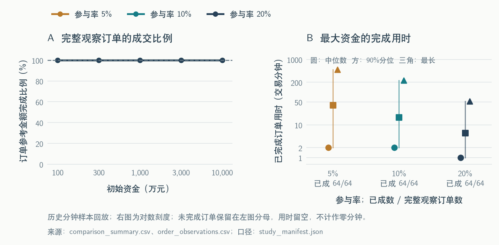
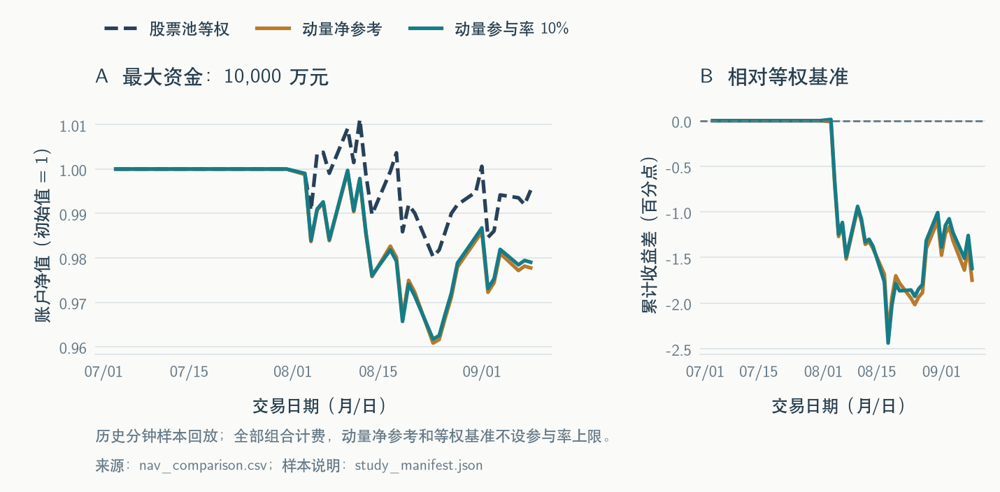
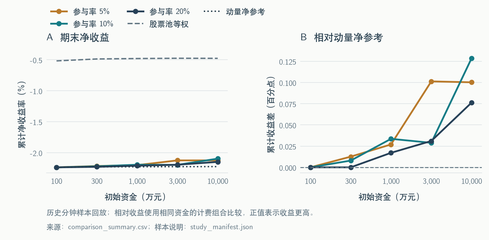
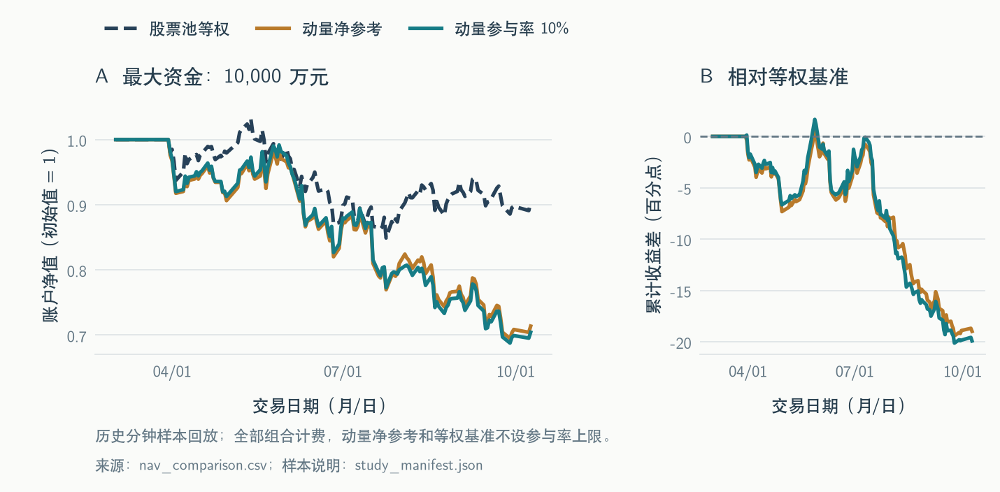
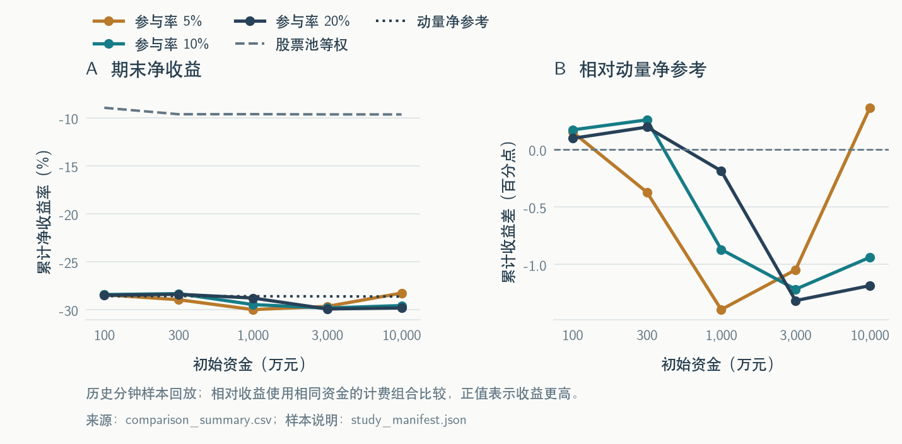
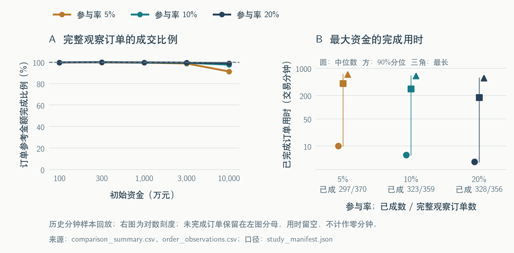

# 真实数据对照实验

**本轮两组真实样本中，动量组合的收益都低于同一股票池等权调仓。** 以 1 亿元、10% 参与率为例，12 股样本的动量收益为 **−2.0976%**、等权为 **−0.4769%**；30 股样本分别为 **−29.5767%** 和 **−9.6531%**。执行方面，12 股补齐末尾观察期后全部成交，30 股同条件的订单金额完成率为 **97.6096%**，仍有到期余单。因此，本轮既得到了选股相对收益的负结果，也查清了哪些订单在当前期限和规则下无法完成。

## 实验怎样比较

因子仍然使用 **20 个交易日价格动量**：当天收盘价除以 20 个交易日前的收盘价，再减 1。因此，每次计算需要连续 21 个有效收盘价。价格来自公司日线的原始收盘价。每 5 个交易日收盘后排序，选择动量最高的 10 只股票等权配置；到下一交易日才开始执行。

为判断选股有没有帮助，同时运行股票池等权组合：在相同调仓日，对当时也具有完整历史数据的全部候选股票等权配置。它也每 5 个交易日调仓，不是只在第一天买入后一直不动。

| 组合 | 选哪些股票 | 是否限制参与率 | 用来回答的问题 |
|---|---|---|---|
| 股票池等权 | 当时历史数据合格的全部候选股票 | 不限制 | 同样持有这批股票，普通等权配置结果怎样 |
| 动量净参考 | 动量最高的 10 只 | 不限制 | 动量选股相对等权配置有没有改善 |
| 动量参与率约束 | 与动量净参考使用同一份目标权重 | 5%、10%、20% | 分批成交以后，收益和完成情况怎样变化 |

“不限制参与率”只是关闭分钟成交量上限，现金、费用、交易单位、已知停牌和涨跌停约束仍然存在。每个资金情景都是独立账户，使用同一段行情进行比较。

另外保留关闭显性交易费用的动量毛参考，检查费用是否足以解释收益差异。每组样本共运行 25 个动量情景和 5 个等权情景；两组共 60 份账户结果均通过现金、持仓、费用及公司行动逐笔对账。

| 共同配置 | 本轮设置 |
|---|---|
| 初始资金 | 100 万、300 万、1,000 万、3,000 万、1 亿元 |
| 参与率 | 5%、10%、20% |
| 执行期限 | 从下一可执行交易日起，最多 3 个交易日 |
| 现金预留 | 目标持仓按账户净资产的 99.5% 计算 |
| 数量规则 | 买卖均按 100 股取整；普通买入股票按 T+1 可卖规则处理 |
| 模型交易费用 | 买入 0.03%，卖出 0.08%；同一母单同一天的累计成交最低收费 5 元 |
| 已知公司行动 | 按登记日持仓确认现金分红及整股送转，按相应日期入账 |

成交价格使用分钟 **VWAP**，即“该分钟成交额 ÷ 该分钟成交量”。例如，一分钟成交额为 100 万元、成交量为 10 万股，VWAP 就是每股 10 元。这里使用公司的分钟增量数据，成交量为零时不成交；VWAP 是回放价格代理。

参与率限制的是这一分钟能成交多少股。假设某股一分钟成交 10 万股，10% 参与率允许账户最多成交 1 万股。若同股两笔订单分别需要 8,000 股和 6,000 股，第一笔成交 8,000 股后，第二笔最多再成交 2,000 股，不能各自再使用一遍 1 万股额度。下一分钟使用下一分钟的新额度，剩余订单继续排队处理。

现金也是整个账户共用的。两笔买单各需 6 万元，账户只有 10 万元时，不能把两笔都按 6 万元成交，手续费也必须包含在支付能力内。同一分钟卖出的回款要到下一分钟才能用于买入。股息应收计入净资产，但尚未到账时不能拿来买股票。新调仓目标到来时，先关闭旧余单，再按已有持仓计算还差多少股，避免重复下单。

09:30 的独立开盘竞价不参与成交；14:58、14:59、15:00 三条记录只用于估值。其他已观察到的分钟成交量用于执行，缺失分钟不补成有成交量的记录。

本文使用下面几个指标：

- **累计净收益**：期末净资产 ÷ 初始资金 − 1。净资产包括现金、股票市值和已确认股息应收；已扣模型交易费用，现金股息按公告含税金额记录。
- **相对收益**：相同资金两账户的累计收益相减，以“百分点”表示。例如，收益 −2% 和 −1% 的差是 −1 个百分点。
- **订单金额完成率**：每笔订单按“股数 × 下单参考价”计量，全部已成交参考金额除以全部下单参考金额。到期、撤销或被替代的需求都保留在分母。
- **完成交易分钟**：从下单后可执行的分钟起，累计到最后一笔成交为止。排除午休、隔夜和上述竞价估值窗；缺行情、零成交量和状态阻塞仍消耗等待时间。均值、中位数、90% 分位和最长用时只统计已完成订单，未完成订单单列。
- **月度收益**：本月最后观察日净值 ÷ 上月最后观察日净值 − 1。起止月份若不足整月，会明确列出截止日；跨月收益应复利连接，不能直接相加。

## 12 只股票：补齐观察期以后，订单是否完成

沿用上一轮的 12 只深市股票，读取 2026 年 7 月 3 日至 9 月 9 日的真实行情，共 49 个交易日、141,708 条原始分钟记录。前 21 个交易日用于形成历史收盘序列，7 月 31 日收盘后产生第一批目标，8 月 3 日开始交易。

最后允许调仓的日期仍为 9 月 4 日。随后补入 9 月 7、8、9 日的行情，只处理已有订单和持仓估值，不再生成新目标。这样，末批订单也获得了完整的三个交易日执行期。

**在本轮配置下，订单全部完成。** 15 个参与率约束情景的金额完成率都是 100%，没有样本末尾尚未观察完的订单。1 亿元账户在三种参与率下均产生 64 笔订单，64 笔全部完成。其中 9 月 4 日收盘后产生的 11 笔新订单，也都在 9 月 7 日成交完毕；5%、10%、20% 参与率下，最晚分别在 09:47、09:36、09:33 完成。因此，此前这批订单没有执行记录，是当时行情结束在下单当日，并不等于已经证明三天内无法成交。

完成比例相同，不代表完成速度相同。1 亿元账户的结果如下：

| 参与率 | 已完成／全部订单 | 金额完成率 | 平均交易分钟 | 中位数 | 90% 分位 | 最长 |
|---|---:|---:|---:|---:|---:|---:|
| 5% | 64／64 | 100% | 17.09 | 2 | 39.8 | 492 |
| 10% | 64／64 | 100% | 8.36 | 2 | 16.8 | 226 |
| 20% | 64／64 | 100% | 3.59 | 1 | 5.7 | 52 |

多数订单只需一两分钟，但 5% 参与率下最慢的一笔需要 492 个交易分钟，跨越了交易日。提高参与率主要缩短了这些较慢订单的完成时间。

**选股收益方面，动量组合低于等权组合。** 1 亿元时，等权净收益为 −0.4769%，不设参与率上限的动量净收益为 −2.2261%，动量账户的净收益低 1.7492 个百分点。两组都没有参与率上限，因此不能把这项差异归因于成交量上限。

加入参与率限制以后，动量净收益分别为 −2.1259%、−2.0976%、−2.1498%。三者都仍低于等权组合，但比各自的动量净参考略高。其中，10% 参与率比动量净参考高 0.1285 个百分点。分批成交在这段行情中提高了最终收益，却没有改变动量组合落后等权组合的结果；也不能由此推出“成交越慢越好”。

资金阶梯保留了同样的结论。下表单位为累计净收益率：

| 初始资金（万元） | 股票池等权 | 动量净参考 | 参与率 5% | 参与率 10% | 参与率 20% |
|---:|---:|---:|---:|---:|---:|
| 100 | −0.518% | −2.238% | −2.238% | −2.238% | −2.238% |
| 300 | −0.487% | −2.230% | −2.217% | −2.222% | −2.230% |
| 1,000 | −0.480% | −2.229% | −2.202% | −2.196% | −2.212% |
| 3,000 | −0.476% | −2.227% | −2.126% | −2.198% | −2.196% |
| 10,000 | −0.477% | −2.226% | −2.126% | −2.098% | −2.150% |

100 万元时，三个参与率情景与动量净参考的收益完全相同，在这一档资金上未观察到由参与率上限造成的收益差异。资金增加后，成交路径开始出现差异，但收益并未随资金或参与率单调变化。

月度结果能进一步说明亏损来自哪些阶段。以下均为 1 亿元账户：

| 月份与截止日 | 股票池等权 | 动量净参考 | 参与率 5% | 参与率 10% | 参与率 20% |
|---|---:|---:|---:|---:|---:|
| 7 月，截至 7 月 31 日 | 0.000% | 0.000% | 0.000% | 0.000% | 0.000% |
| 8 月，截至 8 月 31 日 | −0.519% | −1.615% | −1.506% | −1.526% | −1.553% |
| 9 月，仅截至 9 月 9 日 | +0.042% | −0.621% | −0.629% | −0.580% | −0.606% |

7 月没有实际交易，收益为零。8 月动量账户下跌幅度大于等权账户；9 月前几个交易日，等权账户小幅上涨，动量账户继续下跌。以 10% 参与率为例，这两个阶段分别落后等权约 1.0077 和 0.6220 个百分点。落后并非只集中在末尾尚未完成的几笔订单上，因为本次所有订单都已完成。

## 30 只股票：扩大样本后的表现

这组先使用 2026 年 3 月 2—30 日的 21 个交易日成交额，将股票分为低、中、高活跃度三档，各取 10 只，再查询之后的行情。没有根据后续收益或数据完整程度换掉选好的股票。

行情范围为 3 月 2 日至 10 月 9 日，共 149 个交易日、1,061,239 条原始分钟记录。3 月 30 日收盘后首次调仓，3 月 31 日开始交易；最后一次允许调仓是 9 月 29 日，随后保留 9 月 30 日、10 月 8 日、10 月 9 日三个交易日执行旧订单。

股票数、行情长度和活跃度分布都与前一组不同。两组各自都有完全对应的等权基准，但不能把两组收益差直接解释为“股票更多”带来的效果。

**扩大样本后，动量组合仍然落后，而且差距更大。** 1 亿元账户的等权净收益为 −9.6531%，动量净参考为 −28.6385%，后者低 18.9854 个百分点。10% 参与率下动量净收益为 −29.5767%，低于等权 19.9237 个百分点，也低于动量净参考 0.9383 个百分点。

即使关闭显性交易费用，动量毛参考仍为 −27.9344%。因此，交易费用并不足以解释这组动量组合相对等权的全部落后。

这个结果并不只出现在 1 亿元一档。在全部 15 个参与率约束情景中，动量净收益介于 −29.9958% 和 −28.2765% 之间，全部低于同资金等权组合，相差约 18.62—20.37 个百分点。

| 初始资金（万元） | 股票池等权 | 动量净参考 | 参与率 5% | 参与率 10% | 参与率 20% |
|---:|---:|---:|---:|---:|---:|
| 100 | −8.958% | −28.599% | −28.448% | −28.429% | −28.503% |
| 300 | −9.633% | −28.594% | −28.966% | −28.337% | −28.399% |
| 1,000 | −9.623% | −28.603% | −29.996% | −29.473% | −28.790% |
| 3,000 | −9.648% | −28.616% | −29.663% | −29.832% | −29.930% |
| 10,000 | −9.653% | −28.638% | −28.277% | −29.577% | −29.823% |

等权账户的收益本身也会随资金变化。整手数量和最低费用使不同资金账户不能完全按比例复制，所以每项动量结果都与相同资金的等权账户比较。

**成交方面，大资金账户有明显的未完成需求。** 所有订单都有完整观察期，没有因样本提前结束而无法判断的订单。金额完成率如下：

| 初始资金（万元） | 参与率 5% | 参与率 10% | 参与率 20% |
|---:|---:|---:|---:|
| 100 | 99.7256% | 99.7301% | 99.7371% |
| 300 | 99.7106% | 99.9187% | 99.8919% |
| 1,000 | 99.4682% | 99.5584% | 99.7602% |
| 3,000 | 98.7315% | 99.3694% | 99.4912% |
| 10,000 | 91.2971% | 97.6096% | 98.9112% |

在 1 亿元下，参与率从 5% 提高到 20%，完成率由 91.2971% 提高到 98.9112%，已完成订单的用时也缩短了；但净收益从 −28.2765% 变为 −29.8230%。这段行情里，成交得更多、更快，并没有带来更高收益。

未完成订单不能只看一个总数。下面把 1 亿元账户的订单按期末余量区分。各组的最终未完成状态均为“三个交易日期限已到”，没有样本截断订单。

| 组合 | 全部订单 | 完全成交 | 金额完成率 | 到期未完成 | 其中余量不足 100 股 | 余量仍有 100 股及以上 |
|---|---:|---:|---:|---:|---:|---:|
| 股票池等权 | 761 | 760 | 99.9925% | 1 | 0 | 1 |
| 动量净参考 | 342 | 336 | 99.8841% | 6 | 0 | 6 |
| 动量，5% | 370 | 297 | 91.2971% | 73 | 19 | 54 |
| 动量，10% | 359 | 323 | 97.6096% | 36 | 19 | 17 |
| 动量，20% | 356 | 328 | 98.9112% | 28 | 19 | 9 |

动量净参考自身也没有全部完成，因为关闭参与率上限，并没有关闭现金、行情和证券状态等约束。不同组先前的成交会改变后续持仓和净资产，所以即使用同一套目标权重，最终订单笔数也会不同。

三种参与率下，各有 19 笔余量不足 100 股的订单，全部来自 `000034.SZ`。它在 5 月 19 日发生送股；例如，账户股数以 40 股结尾时，卖出可能剩 40 股，补买到新的整手目标又可能还差 60 股，而当前每次成交仍要求 100 股取整。因此，同一股份尾数会在不同调仓日反复形成小额余单。这 19 笔是订单数，不是 19 只股票，也不能把余量相加当作期末持仓；10% 情景期末该股实际持仓为 40 股。

其他余量仍在 100 股以上的订单，需要结合逐笔过程判断。以 1 亿元、10% 参与率下的 `000529.SZ` 买单为例：9 月 29 日收盘后计划买入 1,377,600 股，随后三个交易日的连续交易分钟行情均有记录，排除既定竞价窗后共 711 条，也没有整根分钟涨停。按“每分钟成交量 × 10%，再向下取 100 股整数倍”计算，三天合计可用额度为 935,900 股，实际也正好成交 935,900 股；剩余 441,700 股到期未成交。**这笔需求确实无法在本轮三个交易日、10% 参与率和整手规则下全部完成。**

这个例子也说明，不能把三天市场总成交量直接乘 10% 当作账户额度：逐分钟取整后的总额度更低。其他到期订单还可能同时受现金、缺报价或涨跌停模型约束。日志中“曾经出现某种约束”记录的是过程，不是全部未成交股数的唯一归因；收盘竞价禁成交也不能被当作全部余单的根本原因。

已完成订单的时间统计如下，未完成订单没有被填成零分钟混入均值：

| 1 亿元账户参与率 | 平均交易分钟 | 中位数 | 90% 分位 | 最长 |
|---|---:|---:|---:|---:|
| 5% | 112.31 | 10 | 411.2 | 703 |
| 10% | 86.52 | 6 | 294.6 | 645 |
| 20% | 47.69 | 4 | 177.2 | 557 |

**月度结果同时保留了较好和较差的阶段。** 以下均为 1 亿元账户；最后一列为 10% 参与率相对等权的当月收益差。

| 月份 | 股票池等权 | 动量净参考 | 参与率 5% | 参与率 10% | 参与率 20% | 10% 相对等权（百分点） |
|---|---:|---:|---:|---:|---:|---:|
| 3 月，仅 3 月 31 日交易 | −2.015% | −2.395% | −1.842% | −1.884% | −1.972% | +0.131 |
| 4 月 | −0.033% | −7.146% | −6.678% | −6.955% | −7.265% | −6.923 |
| 5 月 | −0.967% | +7.128% | +8.314% | +7.553% | +7.406% | +8.519 |
| 6 月 | −9.371% | −11.375% | −11.794% | −11.741% | −11.389% | −2.370 |
| 7 月 | +1.234% | −5.884% | −7.562% | −7.680% | −7.507% | −8.914 |
| 8 月 | +3.438% | −5.279% | −4.863% | −5.410% | −5.787% | −8.848 |
| 9 月 | −2.503% | −7.636% | −7.412% | −7.614% | −7.617% | −5.110 |
| 10 月，仅截至 10 月 9 日 | +0.659% | +0.720% | +0.652% | +0.730% | +0.758% | +0.071 |

5 月是动量表现较好的阶段，10% 参与率比等权高 8.519 个百分点。7 月、8 月则是等权上涨而动量下跌，分别落后约 8.914 和 8.848 个百分点；4 月和 9 月也明显落后。这说明整段亏损不能简单归结为所有股票同步下跌，当前选股和调仓规则在多个阶段的结果弱于等权配置。

3 月包含预热期，实际从 3 月 31 日才交易；10 月只观察到 10 月 8、9 日两个交易日。表中两个起止月都不是完整月，月度收益也不能直接相加当作累计收益。

## 结果的适用范围

本轮确实使用了公司导出的真实分钟、日线和 MySQL 辅助数据，已知的可执行现金分红及整数送股也进入了账户账本。原 12 股的 588 个股票交易日，日线收盘与分钟末价全部核对一致。扩大样本的 4,470 个预期股票交易日中，日线缺 5 个；能够同时比较的 4,406 个股票交易日收盘价一致。扩大样本的分钟候选网格缺 15,963 条，其中 64 个股票交易日整日没有分钟记录，只有 5 个有已知停牌证据，其余 59 个仍是未解释的行情缺口。实验保留了这些缺口。日线只补充收盘信号和估值，不制造可执行的分钟成交量；订单有完整的日历交易日期限，也不等于这些日期的分钟行情没有缺口。

公司行动的覆盖还存在区间空洞。例如，扩大样本的分红源覆盖缺 10 月 1 日、10 月 3—4 日，配股和股改的月度覆盖未覆盖 10 月 1—9 日；休市日也可能发布公告，不能自动忽略。其他事件族也没有完全排除。已知记录已入账，不等于已证明没有遗漏其他权益事项。具体字段、阶段和缺口见[辅助数据核对记录](company_auxiliary_validation.md)。

本报告的因子是原始价格动量。分红送转可能改变原始价格，也就可能改变动量排名；这与账户是否已收到相应现金和股份是两件事。因此，不能把这里的结论替换成复权收益动量或总回报动量的结论。

股息按公告含税金额入账，个人账户后续股息税未模拟。股份动作只支持本批样本出现的同日可用、同日可交易且应得股数为整数的情况；遇到需要零股分配的情形会拒绝运行。买卖均按 100 股取整、普通买入 T+1 可卖及交易费率仍属于显式演示规则，不是完整认证的历史交易制度。

分钟 VWAP 是价格代理，整根分钟 OHLC 锁板判断是执行约束，不证明真实交易队列中必然可以买到或卖掉。没有模拟买卖价差、盘口排队、跨档交易、自身市场冲击或复杂执行算法。已知正停牌记录会限制执行，ST 只作记录，不事后更换股票；状态表没有记录的日期仍不能自动解释为已经证实正常交易。

行情库按 D+1 批量入库，历史同键数据可以修订。这里按市场发生时间回放，不声称完整恢复了当时数据库可见的历史版本。最低收益、最低完成率等业务要求尚未确定，容量状态保持 `threshold_not_set`，本报告不输出最大可用资金数。

本轮源码与复现、图表重画和验证记录见[使用说明](使用说明.md)。此前的合成与12股初始实验报告保留在仓库原位置。
